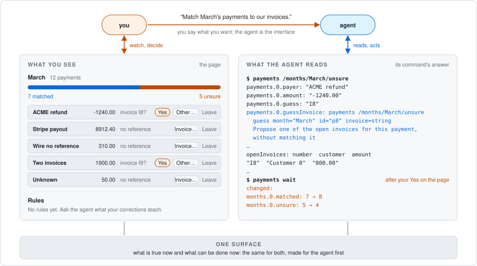

# babavoss

A framework for agent-first apps. Your agent operates the app, and you get a page to follow along and decide.



## Getting started

Ask your agent to install it:

```text
Read https://babavoss.org/llms.txt and install babavoss.
```

Or install it yourself. You need [Bun](https://bun.sh).

To use it in every project:

```sh
bunx skills add alanremarc/babavoss -g
```

To use it in one project, run this in the project's directory:

```sh
bunx skills add alanremarc/babavoss
```

A user-level install stores its data in `~/.babavoss`. A project install stores its data in the project's `.babavoss/` directory, which git ignores. You can commit the skill so your team gets it too. Apps you build with babavoss work the same way.

Then tell the agent what you want:

```text
/baba I want an app that matches each month's payments to our invoices.
```

The agent writes the app, and you can test it before you use it.

## Status

babavoss is at an early stage and still changing. It is tested on macOS with Claude Code and Codex. The design is described in [docs/DESIGN.md](docs/DESIGN.md).

License: Apache 2.0.
